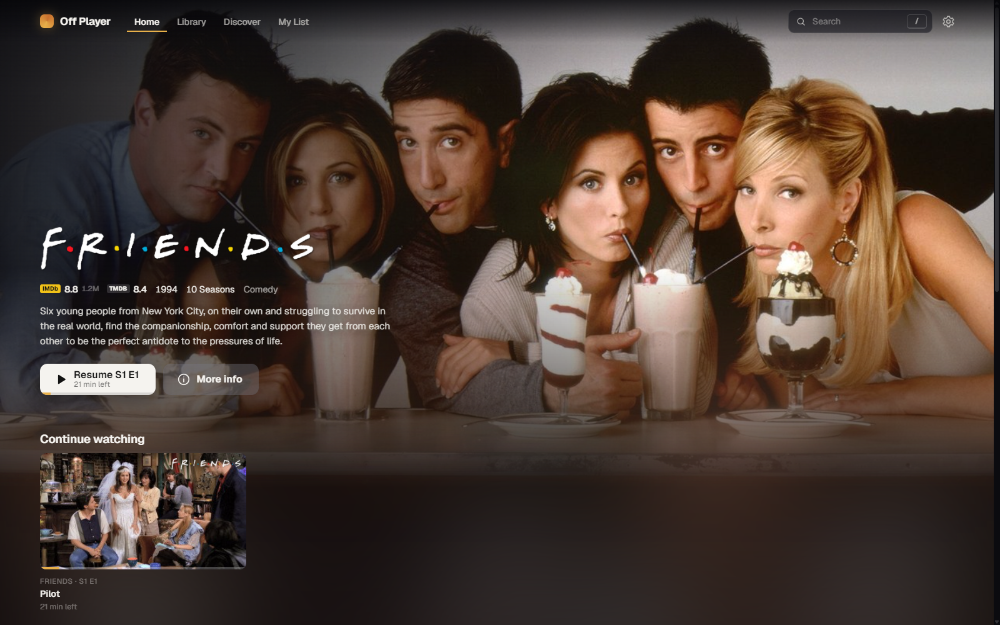

# Off Player

A free Windows app for watching the shows and movies you own, and finding what to watch next.



**[Download the installer from Releases](https://github.com/kr40/off-player/releases/latest)** · [Install notes](docs/INSTALL.md) · [Design and build history](PLAN.md)

## What it does

- **Your library, like a streaming service.** Point it at your folders; it reads shows, seasons, episodes and movies from the file names, adds posters, episode names and ratings from TMDB, and keeps your place: Continue Watching, resume, next-episode countdown, watched marks, per-show audio and subtitle choice.
- **A real player.** Plays practically any file through embedded mpv, with hardware decoding, 5.1 sound, embedded and external subtitles, scrub previews, an episode list, speed and keyboard shortcuts.
- **Skip intro.** Finds each episode's title sequence (and, where the music repeats, the end credits) on your PC by comparing the audio of a season's episodes, then offers a Skip intro button (S) or skips by itself. Markers can be corrected from the player menu.
- **Find what to watch next.** Discover with suggestions from what you've watched, Browse with every TMDB filter, 111 Top Lists (Top 250s, genres, eras, themes, countries), 32 franchises in release or story order, Coming Soon, person pages and one search for everything.
- **Optional IMDb ratings**, imported on your PC from IMDb's public data files.
- **Private.** No account. Nothing about what you own or watch leaves your PC; it only talks to TMDB (and IMDb's data files if you turn them on).

Off Player needs a free [TMDB](https://www.themoviedb.org/) API key for artwork and Discover; set-up walks you through it. Without one, your library still plays.

App shortcuts: `/` search, Esc / Backspace / mouse back button go back, `g` then `h`/`l`/`d`/`m`/`s` jumps to a section, arrows move between posters, `W` / `L` mark watched / watchlist, `?` lists everything.

Cached artwork, thumbnails and the audio fingerprints used to find intros (`fingerprints\`, about 25 KB per episode) live in `%LOCALAPPDATA%\com.offplayer.app\`; your library database lives in `%APPDATA%\com.offplayer.app\`.

## Licence

Off Player is free software under the [GNU General Public License v3.0 or later](LICENSE). The installer bundles mpv (GPL) and FFmpeg (LGPL); see [THIRD_PARTY.md](THIRD_PARTY.md) for versions and source code.

This product uses the TMDB API but is not endorsed or certified by TMDB. IMDb information is used with permission, courtesy of IMDb (https://www.imdb.com). TMDB's and IMDb's terms allow personal, non-commercial use only.

## Build from source

Requires Node, Rust (`rustup`; if `cargo` isn't on PATH in your shell, prepend `%USERPROFILE%\.cargo\bin`) and the MSVC C++ build tools. The bundled binaries in `src-tauri/lib/` are not in the repository:

- `npx tauri-plugin-libmpv-api setup-lib` downloads `libmpv-2.dll` and `libmpv-wrapper.dll` into `src-tauri/lib/`.
- FFmpeg: unzip `ffmpeg-n9.0-latest-win64-lgpl-shared-9.0.zip` from [FFmpeg-Builds](https://github.com/FFmpeg-Builds/FFmpeg-Builds/releases) and copy the contents of its `bin` folder (ffmpeg.exe, ffprobe.exe and the DLLs) plus `LICENSE.txt` into `src-tauri/lib/ffmpeg/`. Without it the app falls back to an ffmpeg on your PATH, or runs without thumbnails and intro detection.

```bash
npm install
npx tauri-plugin-libmpv-api setup-lib
npm run tauri dev
```

The library database lives at `%APPDATA%\com.offplayer.app\offplayer.db`.

## Installer

```bash
npm run tauri build
```

Produces `src-tauri/target/release/bundle/nsis/Off Player_1.0.0_x64-setup.exe` (80 MB, per-user install, no admin). The installed app uses the same library database as development builds, and backs it up to `%APPDATA%\com.offplayer.app\backups` before any version change. FFmpeg (LGPL shared build, `src-tauri/lib/ffmpeg/`, see `SOURCE.txt`) is bundled and used before any copy on PATH. `npm run build` also regenerates the licence list shown in Settings → About.

## Data scripts (dev app must be running with the debug port)

- `node scripts/resolve-keywords.mjs`: resolves the Top List theme keywords from TMDB and writes `src/discover/keywords.ts`.
- `node scripts/build-franchises.mjs`: resolves `src/discover/franchises/source/*.json` to TMDB ids and writes `data.json`; fails on anything unresolved or ambiguous.
- `node scripts/frame-probe.mjs scroll|rowscroll|order|menu|idle`, `node scripts/shift-probe.mjs "<selector>" "<text>"`, `node scripts/viewport-check.mjs <dir>`: frame-time, layout-shift and window-size checks from PRD 2.0 §11.

To regenerate icons after editing `app-icon.svg`: `npx tauri icon app-icon.svg` (then delete the generated `android` and `ios` folders).

## Tests

```bash
npm test
```

Parser tests run against `src/library/__fixtures__/sample-library.json`, the file and folder layout of a real three-show library (release tags made generic).

Rust tests (`cargo test --lib` in `src-tauri`) include the intro detector on synthetic audio. To measure it on a real season, write `path<TAB>duration` lines (one season, episode order) to a file and run, with ffmpeg on PATH:

```bash
OFFPLAYER_SEG_LIST=season.txt cargo test --lib real_season -- --ignored --nocapture
```

## Player shortcuts

| Key | Action |
|---|---|
| Space / K | Play / pause |
| ← / → or J / L | Back / forward 10 s (Shift: 1 min) |
| 0 – 9 | Jump to 0–90 % |
| ↑ / ↓ or mouse wheel | Volume |
| M | Mute |
| C / A | Next subtitle / audio track |
| S (or Enter) | Skip intro, while the button shows |
| N / P | Next / previous episode |
| E | Episodes drawer |
| [ / ] / = | Slower / faster / normal speed |
| , / . | Frame back / forward |
| F / double-click | Fullscreen |
| I | Stats (including dropped frames) |
| ? | Shortcuts overlay |
| Esc / Backspace | Close panel, exit fullscreen, then back |

## Development hooks

| Variable | Effect |
|---|---|
| `OFFPLAYER_SEED_LIBRARIES` | `;`-separated folders added and scanned on start-up when the library is empty |
| `OFFPLAYER_START_MUTED` | Player starts muted (for automated checks) |

## Checking the window

- **Preferred:** start the app with `WEBVIEW2_ADDITIONAL_BROWSER_ARGUMENTS=--remote-debugging-port=9229` (and `OFFPLAYER_START_MUTED=1`), then drive it with `node scripts/cdp.mjs` (`eval`, `click x y`, `hover x y`, `wheel x y dy`, `key …`, `shot file.png`) and find targets with `node scripts/at.mjs "<selector>" "<text>"`. Real hover, no effect on the real mouse or keyboard. Page screenshots exclude the mpv video; use `peek.ps1` for those.
- `scripts/hover-probe.mjs` — measures the Home series-card hover frame by frame (frame times, card shift, overlap into neighbours).
- `scripts/hover-audit.mjs deadzone|ring` — moves a pointer down from each row into the next and reports rows that don't respond; hovers cards on the current page and reports outlines that would be clipped.
- `scripts/awake.ps1` — shows whether something holds "display required" (keep-awake) without admin rights.
- `scripts/peek.ps1` — captures the window and sends clicks/keys as window messages, **without** taking focus or moving the mouse. Prefer this.
- `scripts/snap.ps1` — brings the window to the front and uses the real mouse/keyboard. Only when nobody is using the PC.

```bash
powershell -File scripts/peek.ps1 -Out shot.png -ClickX 700 -ClickY 497 -Key I
```

`peek.ps1` also takes `-Key PageDown` (scroll the page), `-Text "..."` (type into the focused field) and `-Hover` (move without clicking; unreliable, since Windows cancels hover when the real cursor is elsewhere). Coordinates are relative to the window's top-left, matching the saved screenshot.

- `scripts/checkmeta.py` — read-only summary of matches, artwork and episode mapping from the library database:

```bash
python -I scripts/checkmeta.py "%APPDATA%\com.offplayer.app\offplayer.db"
```
